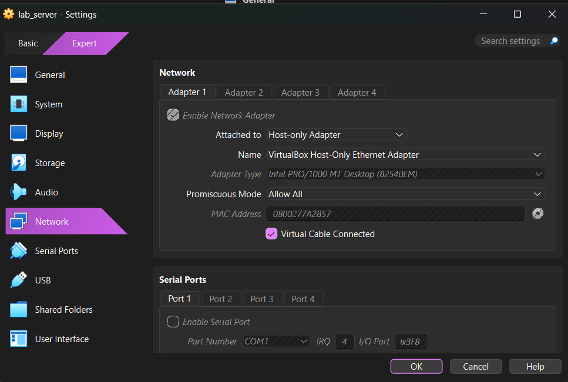
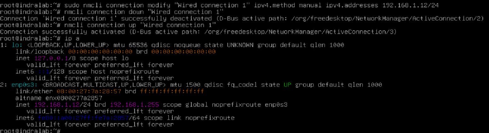
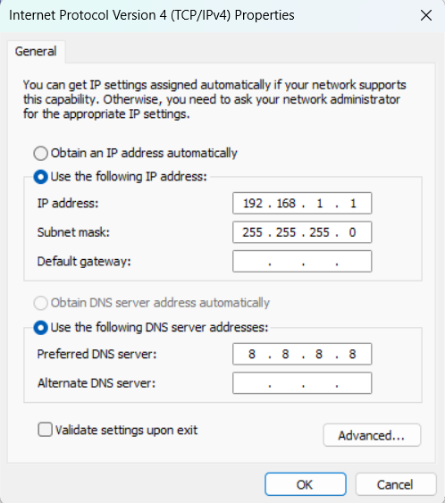
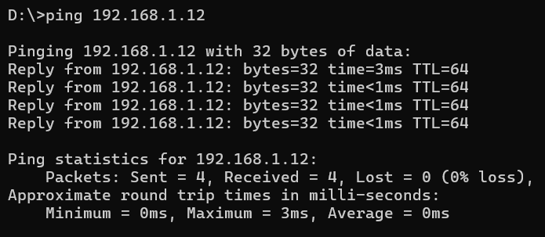
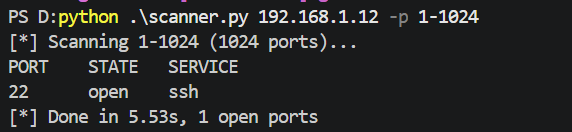
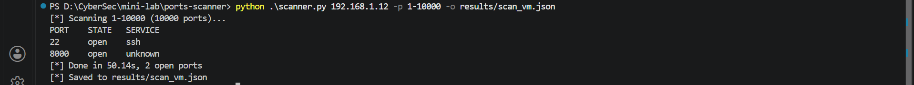

# Scanner Port Use Python

Simple Port Scanner menggunakan bahasa Python. Proyek ini dibangun untuk mempelajari cara kerja koneksi TCP(Three-way Handshake). Scanner menggunakan metode TCP Connect Scan dengan multithreading untuk mempercepat proses pemindaian. Hasil scanning dapat ditampilkan dalam bentuk tabel(tidak tersimpan) atau dalam bentuk json(tersimpan). Dalam praktik ini menggunakan keamanan dimana membatasi hanya alamat IP lokal (loopback atau private).

# Fitur

1. Scan port tunggal, daftar, atau range  
2. Multithreading  
3. Output tabel \+ JSON  
4. Guard: hanya target loopback/private 

# Instalasi VM

1. Install VM(disini menggunakan debian 13\) menggunakan Oracle Virtual Box atau VmWare  
2. Setup VMmenggunakan Host-Only Adapter  
   
3. Setup manual IP Address vm  
   
4. Setup manual adapter pada PC Host(pastikan IP memiliki subnet yang sama)  
   
5. Lakukan tes ping dari PC Host ke VM
   

# Penggunaan Script

Script memiliki beberapa option seperti host(wajib ada), `-p` atau `--ports` untuk seleksi port, `-t` atau `--threads` untuk mengatur jumlah thread yang akan bekerja secara bersamaan, `--timeout` untuk mengatur batas maksimal waktu tunggu, `-o` atau `--output` untuk mengatur lokasi file output.  
Selanjutnya, bagaimana menggunakan script.

1. Import script(bisa diunduh dengan ZIP atau clone repo)  
2. Perintahkan `python script.py [ip yang dituju] -p [port yang dituju]`  
   
3. (jika ingin menyimpan dalam file)  
4. Perintahkan `python script.py [ip yang dituju] -p [port yang dituju] -o resuts/[nama file].json`  
   

# Cara Kerja Script

Script bekerja dengan 5 langkah utamanya, berikut saya ringkas.

1. Pengecekan keamanan, fase memastikan jika IP memang adalah IP lokal/private  
2. Parsing, pada seleksi port(1-1024) akan dirubah menjadi satu per satu nilai  
3. Multithreading, fase membagi tugas scan keratusan thread sekaligus  
4. TCP Connect Scan, Mencoba melakukan three-way pada seluruh port. Apabila berhasil (`connect_ex == 0`) maka port akan ditandai `OPEN`  
5. Reporting, fase penyampaian hasil baik dalam terminal atau file

# Perbandingan dengan NMAP

Script port scanner yang dikembangkan memiliki beberapa perbedaan mendasar dibandingkan dengan Nmap, baik dari segi implementasi, performa, maupun kebutuhan sistem. Dari sisi keunggulan, script ini dirancang agar tetap ringan karena hanya membutuhkan Python tanpa memerlukan instalasi perangkat lunak tambahan atau dependensi biner berukuran besar. Selain itu, source code bersifat terbuka sehingga mudah dipahami, dimodifikasi, dan dikembangkan sesuai kebutuhan. Script ini juga dilengkapi dengan mekanisme pengamanan bawaan untuk membatasi potensi penyalahgunaan.

Dari segi performa, Nmap cenderung memiliki kecepatan pemindaian yang lebih tinggi karena mendukung metode SYN Scan (Half-Open Scan). Metode ini bekerja dengan mengirimkan paket SYN ke port target dan mengidentifikasi status port berdasarkan respons yang diterima. Ketika memperoleh respons SYN-ACK, Nmap dapat menyimpulkan bahwa port berada dalam kondisi terbuka tanpa harus menyelesaikan proses Three-Way Handshake. Selanjutnya, Nmap mengirimkan paket RST untuk mengakhiri proses koneksi. Sementara itu, script yang dikembangkan masih menggunakan pendekatan koneksi TCP standar yang mengharuskan proses Three-Way Handshake diselesaikan terlebih dahulu. Hal tersebut menyebabkan proses pemindaian membutuhkan waktu dan resource yang relatif lebih besar dibandingkan SYN Scan.

Sebagai rencana pengembangan, script ini berpotensi ditingkatkan dengan memanfaatkan Raw Socket melalui library Python seperti Scapy untuk mempelajari dan mengimplementasikan mekanisme SYN Scan. Selain itu, fitur Banner Grabbing juga direncanakan untuk ditambahkan agar script tidak hanya mampu mengidentifikasi status port, tetapi juga memperoleh informasi mengenai layanan dan versi perangkat lunak yang berjalan pada port tersebut. Dengan pengembangan tersebut, diharapkan kemampuan script dapat semakin mendekati fungsionalitas Nmap tanpa menghilangkan karakteristik utamanya, yaitu ringan, terbuka, dan mudah dimodifikasi.

# Hal yang di Pelajari

1. Memahami Perilaku connect\_ex() vs connect()  
   Saya belajar bahwa fungsi connect\_ex() jauh lebih efisien untuk port scanner dibandingkan connect() biasa. connect\_ex() mengembalikan kode error (seperti 0 untuk sukses, atau 111 untuk Connection Refused), sehingga program tidak akan crash saat menemukan port yang tertutup. Ini mengajarkan saya cara menangani exception di level jaringan tanpa harus membungkus setiap socket dengan blok try-except yang berat.  
2. Trade-off Antara Jumlah Thread dan Resource (GIL & I/O Bound)  
   Saya menyadari bahwa port scanning adalah operasi I/O Bound (menunggu balasan jaringan), bukan CPU Bound. Oleh karena itu, multithreading sangat efektif di sini. Namun, saya belajar batas optimalnya: menaikkan jumlah thread dari 50 ke 200 mempercepat waktu scan, tetapi jika terlalu tinggi (misal 1000), sistem operasi justru akan menghabiskan resource hanya untuk berpindah antar thread (context switching), dan beberapa koneksi bisa gagal karena file descriptor yang habis.  
3. Perbedaan Nyata Antara Closed dan Filtered (RST vs Timeout)  
   Melalui eksperimen dengan firewall di VM Debian, saya memahami perbedaan teknis yang nyata:  
   1. Closed: Jika target membalas dengan paket RST (Reset), koneksi langsung ditolak. Waktu scan menjadi sangat cepat.  
   2. Filtered: Jika target membalas dengan silent drop (seperti yang dilakukan ufw atau iptables), script saya harus menunggu hingga batas \--timeout habis. Saya belajar bahwa timeout yang terlalu besar akan memperlambat scan secara drastis, sedangkan timeout yang terlalu kecil (misal 0.1s) bisa menghasilkan false negative (port terbuka dianggap tertutup) jika jaringan sedang sibuk.  
4. Kompleksitas Virtual Networking (Host-Only vs NAT)  
   Mengonfigurasi Host-Only Adapter di VirtualBox memberikan pelajaran berharga bahwa jaringan VM itu rumit. Saya belajar bahwa Host-Only membutuhkan konfigurasi routing manual antara host dan guest. Error Destination host unreachable yang saya alami membuktikan bahwa tanpa IP statis yang se-subnet (dan gateway yang tepat), paket tidak akan pernah sampai. Ini mengajarkan saya untuk tidak menganggap remeh konfigurasi network interface (nmcli) sebelum menyalahkan kode scanner.
